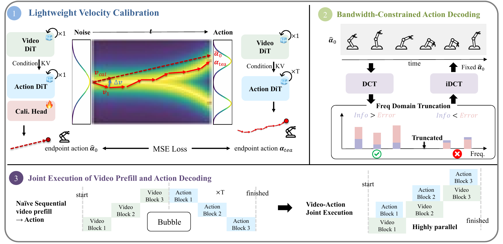
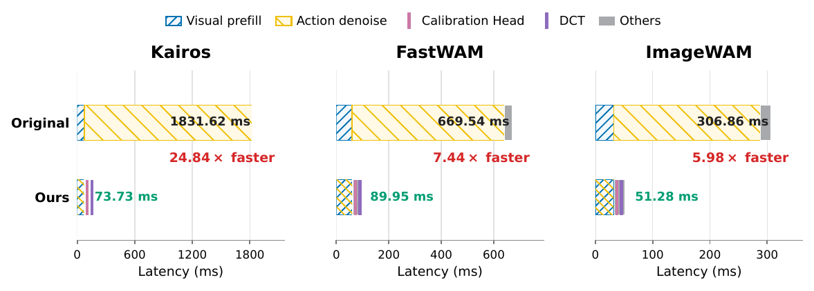
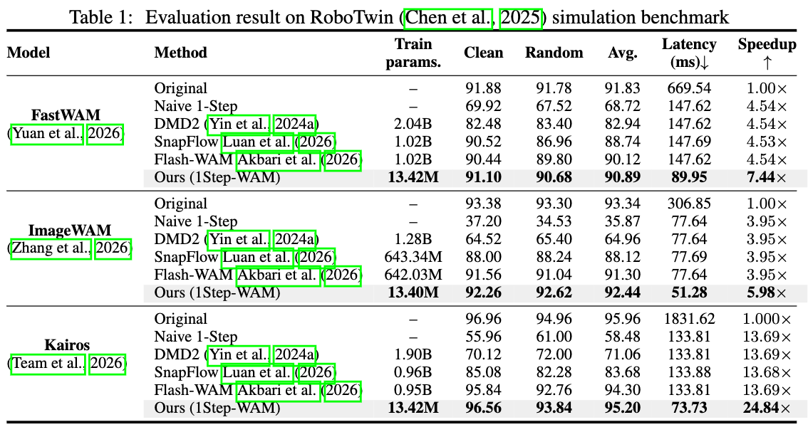
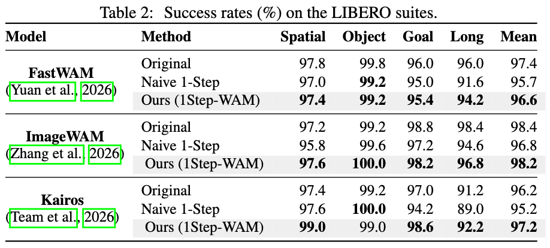
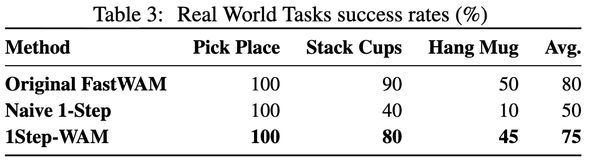
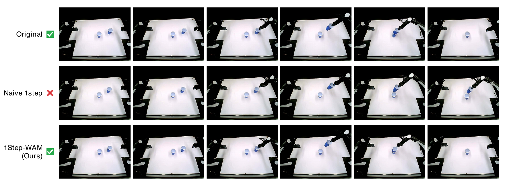
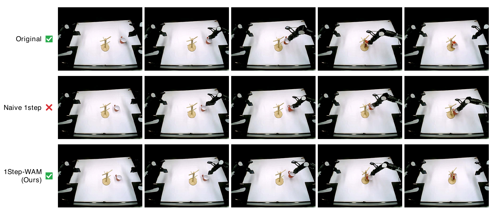
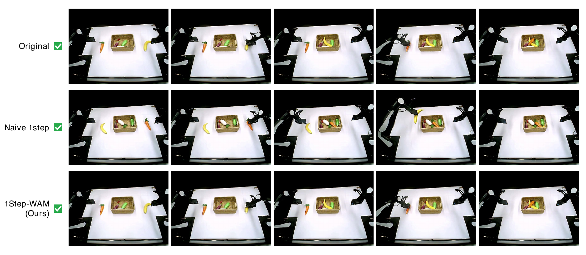

# 1Step-WAM: Your World Action Model but Faster Using 1-Step Action Generation

<div align="center">

<!-- **One-step, parallel action generation for pretrained World Action Models** -->


[](https://github.com/ModelTC/LightX2V/blob/main/LICENSE)&nbsp;
[](https://arxiv.org/abs/2610.15625)&nbsp;


</div>

<p align="center">
  
</p>

## 💡 Overview

The deployment of World Action Model (WAM) is often limited by iterative action denoising and serial video-action execution. **1Step-WAM** turns a pretrained multi-step WAM into a one-step action generator while retaining the original backbone.

1Step-WAM combines three complementary components:

1. **Lightweight velocity calibration.** A small calibration head corrects the initial ActionDiT velocity prediction toward the multi-step teacher endpoint while the WAM backbone stays frozen.
2. **Bandwidth-constrained action decoding.** A temporal DCT projection retains low-frequency action modes and suppresses residual prediction error.
3. **Joint video--action execution.** Each action block starts as soon as its required visual K/V cache is available, overlapping action decoding with video prefill.

## ✨ Highlights

<p align="center">
  
</p>

- ⚡ **One action-generation pass:** replaces iterative action denoising with a calibrated single forward pass.
- 🪶 **Parameter efficient:** trains only a 13.4M-parameter calibration head.
- 🔧 **Backbone general:** evaluated on FastWAM, ImageWAM, and Kairos.
- 🚀 **End-to-end acceleration:** achieves **5.98x-24.84x** speedup on a single NVIDIA L40 GPU while preserving most of the original task success rate.

## 📊 Evaluation Results

### RoboTwin

<p align="center">
  
</p>

On RoboTwin, 1Step-WAM achieves the best average success rate among the evaluated one-step methods for all three backbones, with end-to-end speedups of **7.44x**, **5.98x**, and **24.84x** for FastWAM, ImageWAM, and Kairos, respectively.

### LIBERO

<p align="center">
  
</p>

Across the four LIBERO suites, 1Step-WAM closely matches the multi-step policies on FastWAM and ImageWAM, and reaches highest mean success (**97.2%**) with the Kairos backbone.

### 🤖 Real-World Tasks

We evaluate FastWAM-based policies on an AIRBOT Play robot across Pick Place, Stack Cups, and Hang Mug. 1Step-WAM attains **75%** average success, compared with **80%** for the original multi-step FastWAM policy and **50%** for naive one-step generation.

<p align="center">
  
</p>


**Stack Cups.** 
<p align="center">
  
</p>


**Hang Mug.** 
<p align="center">
  
</p>

**Pick Place.** 

<p align="center">
  
</p>


## 📝 Citation
```
@article{su20261step,
  title={1Step-WAM: Your World Action Model but Faster using 1-Step Action Generation},
  author={Su, Rundong and Chen, Pengtao and Geng, Haohan and Zhang, Sha and Yuan, Zhihang and Rong, Yicheng and Yu, Chong and Huang, Hao and Chen, Tao},
  journal={arXiv preprint arXiv:2610.15625},
  year={2026}
}
